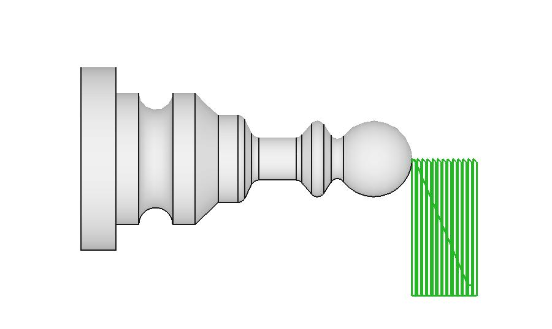
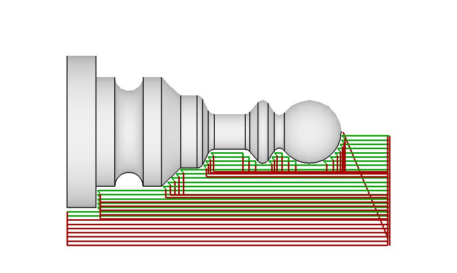
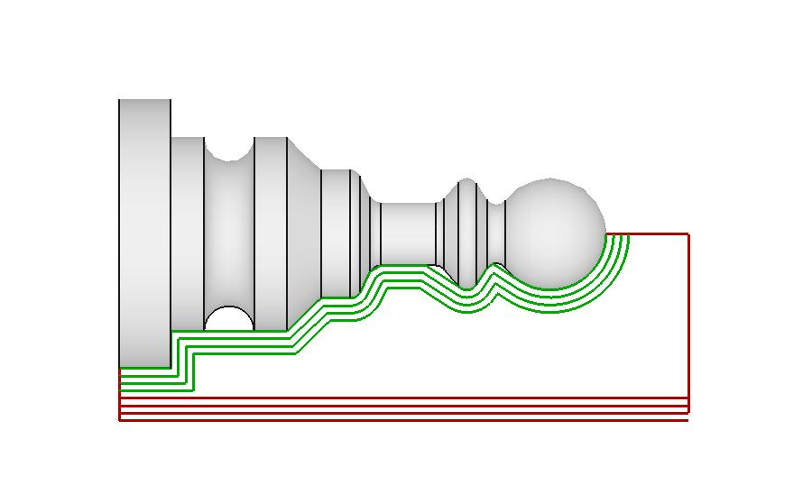
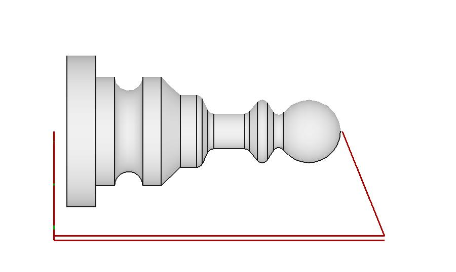

# LibLathe [](https://github.com/dubstar-04/LibLathe/actions) [](https://codecov.io/gh/dubstar-04/LibLathe/branch/master/) [](https://pypi.org/project/liblathe/) 

LibLathe is an opensource standalone python library for generating turning paths and gcode for use with cnc lathes.

| :warning: WARNING: LibLathe is currently experimental / Proof of concept and only suitable for testing. |

## Installation
Installing liblathe from PYPI
```
pip install liblathe
```

Local install for testing
```
pip install .
```

:warning: Some systems require that packages are system installed. Liblathe can be installed for development purposes.
Note: This may break your system
```
pip install . --break-system-packages
pip uninstall liblathe --break-system-packages
```

## Build
Liblathe is a python library with a C++ core. Liblathe core can be compiled and tested inplace using the following steps:

Native C++ types live in the `liblathe` namespace, for example `liblathe::Point`.
Python module and class names are unchanged. Rebuild all five native extensions
together when updating the native headers.

```
cd Liblathe
cmake .
make
```

Local testing
```
python3 ./examples/defeature_example.py
```

## Tests

After building, run the Python suite with `pytest --ignore=extern`, as used by
the test workflows. These tests exercise the compiled C++ core through Python.

The [native memory driver](tests/native/quadtree_memory.cpp) is an optional
diagnostic for investigating C++ memory issues, not a required test or CI step.
Its header contains the manual build and sanitizer instructions.

## Design
Part profiles are lines and arcs in X (radius) and Z (axis). LibLathe plans cuts in two geometry steps:

1. **Defeature:** the tool is moved along the part and only the area it can actually reach is kept, removing features that can't be turned, such as undercuts.
2. **Offset:** a signed distance field (SDF) gives the distance from any point to the profile. A quadtree samples it, refining only near the target distance. Points at that distance are collected, ordered and simplified with the Ramer-Douglas-Peucker (RDP) algorithm into the offset path.

The operations (face, rough, profile and part-off) combine these steps into toolpaths and gcode. The geometry core is C++ exposed to Python with pybind11.

Defeature retains the complete line/arc insert footprint and checks containment
as well as edge crossings. Returned points are tool origins, not contact points.
Connecting moves and simplified chords must pass an adaptive full-footprint
sweep check against the original part. Unsafe direct connectors use a verified
axis-aligned route; geometry that cannot be certified within coordinate
precision or the subdivision limit raises an error instead of returning an
unchecked move. This checks the defeature envelope only, not subsequent offsets,
operation paths, or stock clearance on entry and retract moves.

G-code entry and retract routing uses the complete rotated insert bounds to keep
rapid moves outside the original stock envelope. The `clearance` parameter must
be finite and non-negative; routing applies a minimum clearance of 0.01 model
units. Approaches and escapes use feed moves at `hfeed`, so these moves may remove
stock. Profile and roughing operations certify the added feeds against the
original part with `SegmentGroup.validateToolSweep`; an uncertifiable approach
or escape raises an error instead of publishing partial commands for that group.
Facing and parting use the same stock-clear rapid routing but may intentionally
cut the original part region. Rebuild the native extensions for the new sweep
validation binding before using the updated Python routing code.

This conservative routing does not track previously cleared stock. It checks
the first rapid destination, not travel from an unknown initial machine position,
and does not certify holders, fixtures, all original cutting moves, or machining
safety. Reference-equivalent final stock remains a separate validation requirement.

`SegmentGroup.getRadialContactPoint()` derives a cutting-edge datum from the
native outline, including arc extrema and the axial midpoint of a flat innermost
edge. Roughing uses it to express physical stock limits in tool-origin coordinates
and anchors its pass grid to the stock, rather than a sampled offset endpoint.
Profile uses the same datum for its lead-in plane. These changes require rebuilt
native bindings; they do not establish reference-equivalent Profile final stock.

The SDF uses the profile closed back to X = 0: sign and distance include the
same boundary. Artificial closing edges do not generate offset candidates;
faces explicitly included in the profile remain eligible. The existing
start-Z clip is retained. In LibLathe's plotted view, Z is horizontal and X
increases downward from the centreline.

Offset extraction retains nearest-neighbour ordering when it passes the contour
certificate. If that ordering fails, the same candidate points are reordered
along the original profile, including corner arcs, and checked again against
the unchanged 0.05 model-unit accuracy limit. Uncertifiable or collapsed contours
still raise an error; chord failures report their endpoints and midpoint error.

See [ARCHITECTURE.md](ARCHITECTURE.md) for the trade-offs and alternative approaches.

## Spindle Side

`Tool.side` requires a `ToolSide` enumeration member from
`liblathe.tool.tool`: `ToolSide.NEAR` (default, positive X) or
`ToolSide.FAR` (negative X). Strings are rejected. This development API
requires an updated build; an older package reporting 0.0.8 may lack the enum.
Supply the tool outline in its actual physical orientation. For Far, supply
negative-X part and stock geometry too; positive-X stock or part inputs are
rejected. `BaseOP.getGCode()` plans on reflected copies of all three inputs,
then returns physical signed commands and `tool_paths`. Reflection reverses
segment bulges, G2/G3 and I offsets, including rapid and retract X positions.
Original inputs are not modified, and near-side behavior is unchanged.

The returned Far-side commands remain negative X. X positions and I arc-centre
offsets are negated; G2/G3 are swapped. Z, K and feed values are unchanged.
Side does not choose spindle speed, M3/M4, tool handedness or controller G41/G42.
The machine integration must match this signed-X contract to its controller.

This selects the spindle side, not inside/outside machining. Internal boring
requires separate operation support. Full operation-path safety and native-tool
precision sensitivity remain unresolved; signed-side output is experimental
and is not machining approval.

## Native Tool Geometry

`Tool.set_tool_from_segments()` accepts the actual XZ insert outline, including
rounded nose arcs. Outline coordinates are relative to the selected tool origin;
returned paths position that origin, not a separately calculated contact point.
The caller supplies the physical pose and datum. LibLathe does not have a
Compensation selector or automatically recenter an imported insert.

Leave `tool_rotation` at zero for geometry that is already rotated. Its optional
rotation acts around the supplied origin; it is not the add-on's absolute insert
angle or a controller Q orientation. Changing `side` does not rotate the stored
insert or select its active nose.

See the [tooling manual](docs/source/pages/liblathe_tooling.rst) for the API,
coordinate conventions and side-planning details.

## Examples
### Facing:


### Roughing:


### Profiling:


### Parting:


## Links
* Docs: https://liblathe.readthedocs.io/en/latest
* CNC: https://en.wikipedia.org/wiki/Numerical_control
* GCode: https://en.wikipedia.org/wiki/G-code
* PyPi: https://pypi.org/project/liblathe/
